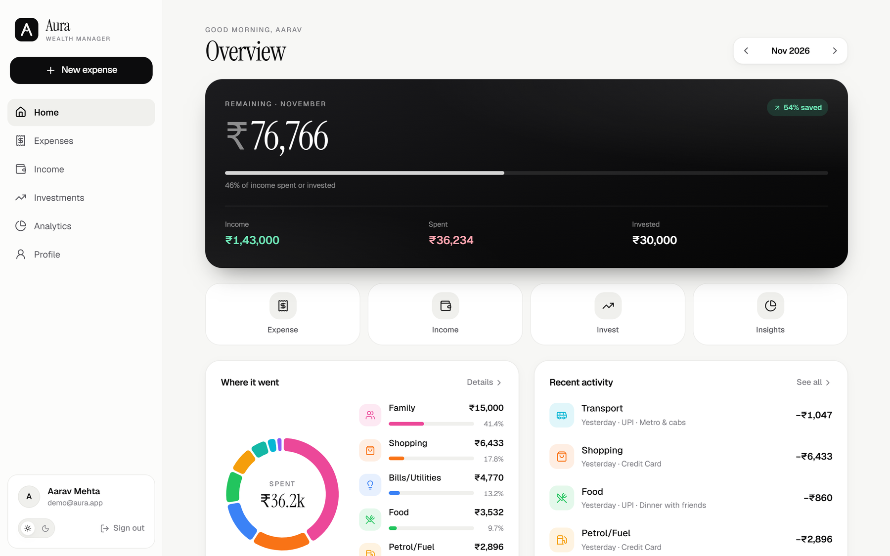
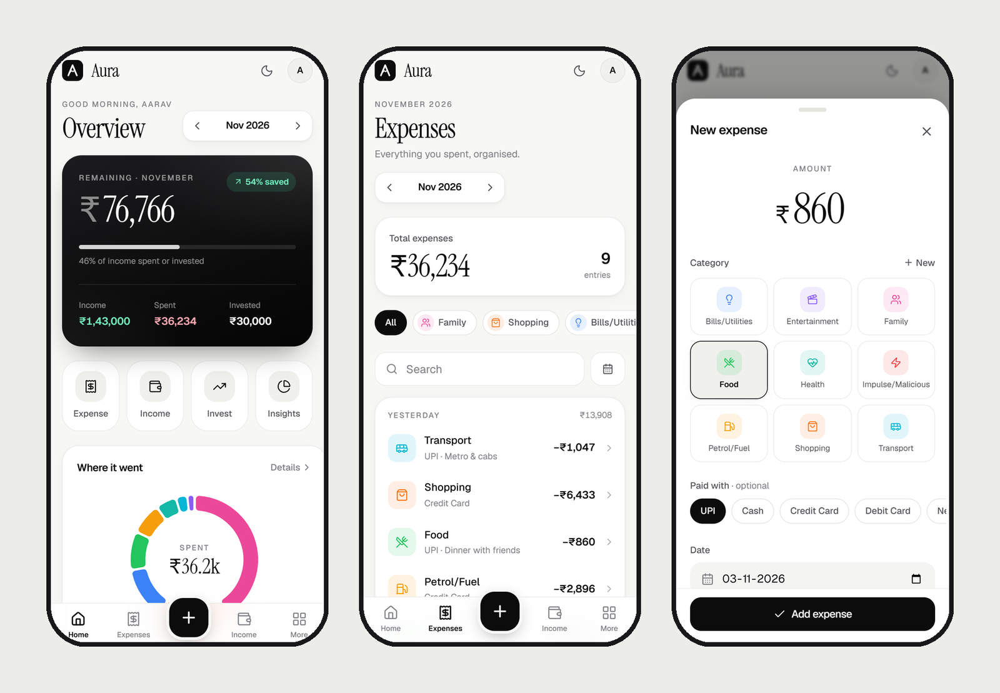
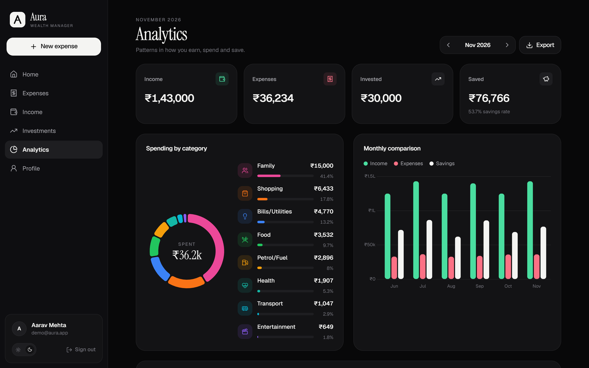
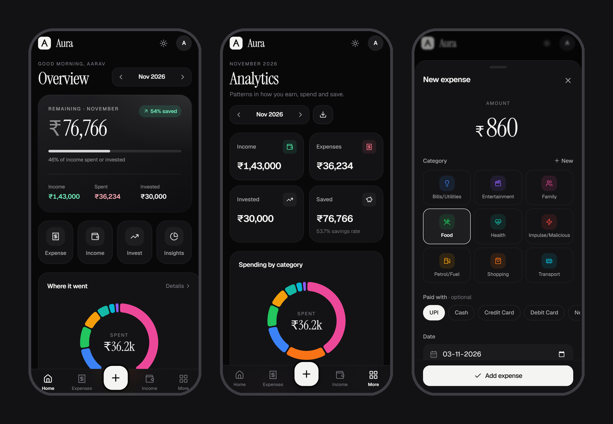

<div align="center">
  <h1>
    
    Aura | Wealth Manager
  </h1>
  
  <br />
  
  <div>
    
    
    
    
    
    
  </div>

  <br />
  <br />

  **Aura is a full-stack, highly aesthetic personal finance platform designed to give users deep, actionable insights into their wealth. Built mobile-first with a premium, classic monochrome design, Aura allows you to seamlessly track your income, categorize daily expenses, and monitor your long-term investments. With dynamic data visualization and smart savings calculations, taking control of your financial future has never looked this good.**
</div>

<br />

<div align="center">
  
  <br/><br/>
  
  <br/><br/>
  
  <br/><br/>
  
</div>

<br />

## ✨ Features

- **Mobile-First Premium UI:** Bottom tab bar with a one-tap add button, bottom-sheet forms, and a calm monochrome design with emerald (income) and rose (expense) accents. Full light and dark themes, with a refined sidebar layout on desktop.
- **Installable App (PWA):** Add Aura to your phone's home screen and it opens full-screen like a native app.
- **Fast After Idle:** A keep-alive ping plus an automatic server warm-up keep the free-tier backend from sleeping (see [KEEP_ALIVE.md](KEEP_ALIVE.md)).
- **Strict Data Isolation:** Custom JWT-based authentication ensures your financial data is completely secure and isolated from other users in the system.
- **Smart Wealth Tracking:** Separates your cash flow (Income vs. Expenses) from your assets (Investments), giving you an accurate "Remaining Savings" calculation.
- **Comprehensive Analytics:** Category donut, monthly comparison bars and six-month trend lines (built with Chart.js) break down your monthly spending habits, transaction counts, and savings rates.
- **Multi-Currency Support:** Track your wealth in INR (₹), USD ($), SAR (﷼), or AED (د.إ).
- **One-Click Export:** Download detailed CSV reports of your monthly financial summaries from the Analytics page.

## 🛠 Tech Stack

### Frontend
- **Framework:** React 19 (Vite)
- **Styling:** TailwindCSS with CSS-variable design tokens (light/dark)
- **Typography & Icons:** Geist, Instrument Serif, Lucide icons
- **Animations:** Framer Motion
- **Data Visualization:** Chart.js (react-chartjs-2)
- **State/Routing:** React Router DOM, Context API, Axios

### Backend
- **Framework:** FastAPI (Python 3.10+)
- **Database:** PostgreSQL (Neon Serverless) via SQLAlchemy ORM (Async)
- **Authentication:** JWT (JSON Web Tokens), Passlib (Bcrypt hashing)
- **Server:** Uvicorn

---

## 🚀 Getting Started (Local Development)

To run this project locally, follow these steps:

### 1. Clone the repository
```bash
git clone https://github.com/insjunaid/AURA-EXPENSE-TRACKER.git
cd AURA-EXPENSE-TRACKER
```

### 2. Setup the Backend (FastAPI)
Open a terminal in the root directory:
```bash
# Create a virtual environment
python -m venv venv

# Activate the virtual environment
# Windows:
.\venv\Scripts\activate
# Mac/Linux:
source venv/bin/activate

# Install dependencies
pip install -r requirements.txt

# Start the FastAPI server
uvicorn app.main:app --reload --port 8000
```

### 3. Setup the Frontend (React/Vite)
Open a **new** terminal, leaving the backend running:
```bash
# Navigate to the frontend directory
cd frontend

# Install dependencies
npm install

# Start the Vite development server
npm run dev
```

### 4. Open the App
Visit `http://localhost:5173` in your browser. The frontend will automatically connect to the local backend API running on port 8000.

---

> **Note on Database:** Out of the box, the backend connects to an async PostgreSQL database via the `DATABASE_URL` environment variable. To test locally, you can modify `app/database.py` to use a local `aiosqlite` file, or supply a free Neon DB Postgres URL in your `.env` file.

<br />

---

<div align="center">
  <h3>Made with 💻 & ❤️</h3>
  <p>Building better tools for better financial futures.</p>
</div>
